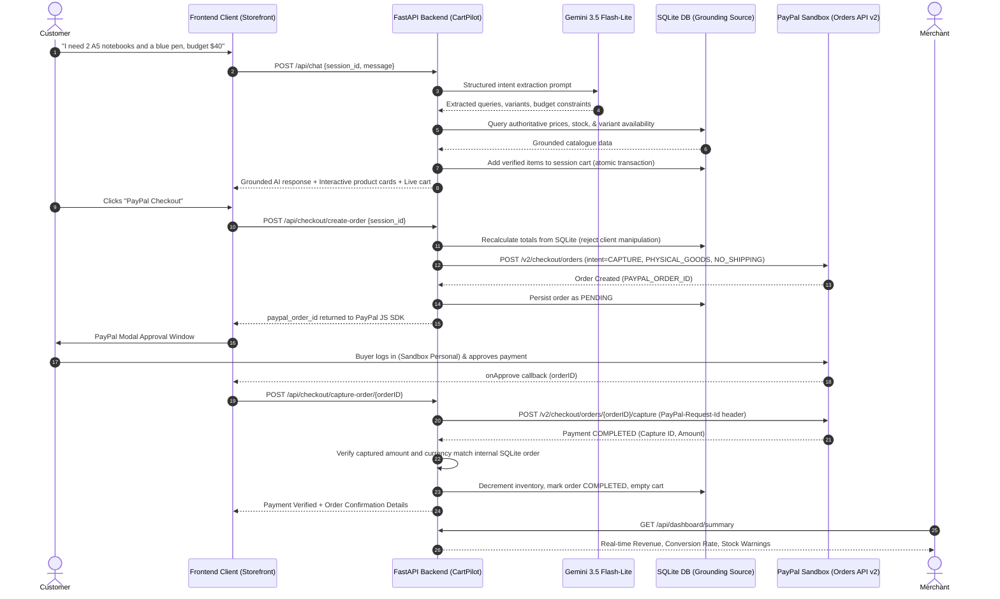

# 🛒 CartPilot AI

> **From conversation to checkout — AI-powered shopping made effortless.**  
> *Developed for the PayPal AI Hackathon 2026*

[](https://www.python.org/)
[](https://fastapi.tiangolo.com/)
[](https://developer.paypal.com/docs/api/orders/v2/)
[](https://ai.google.dev/)
[](#-automated-test-suite-72-tests-passing)
[](LICENSE)

---

## 🌟 Executive Summary

Traditional online shopping forces customers to navigate cumbersome categories, endless search filters, and manual cart configurations. **CartPilot AI** replaces friction with natural conversation.

CartPilot AI is a full-stack conversational commerce platform where **Google Gemini AI** and **PayPal Orders API v2** work in lockstep. Customers state what they need, specify preferences, or declare a budget (e.g., *"I need two A5 hardcover notebooks and a blue pen under $40"*), and CartPilot AI:
1. **Parses customer shopping intent** and extracts quantities, variants, and budget limits.
2. **Strictly grounds recommendations** against an authoritative SQLite inventory database — eliminating AI hallucinations, fabricated prices, and ghost stock.
3. **Synchronizes a persistent multi-session cart** with real-time recalculations and deduplication.
4. **Executes server-side PayPal Sandbox checkout** via PayPal Orders API v2 and the PayPal JavaScript SDK, with robust server-side capture verification and fraud-prevention checks.
5. **Provides a real-time Merchant Operations Dashboard** to monitor gross revenue, order fulfillment states, and low-inventory alerts.

---

## 🏗️ Architecture & Data Flow



---

## 🚀 Key Features

### 1. Conversational AI Shopping Assistant
- **Natural Language Understanding**: Powered by Google Gemini 3.5 Flash-Lite (`gemini-3.5-flash-lite`) with structured Pydantic schema generation (`ShoppingIntentResponse`).
- **Strict Catalogue Grounding**: The AI is never trusted to determine prices, calculate subtotals, or confirm inventory. Every extracted item is queried against SQLite.
- **Variant & Constraint Resolution**: Intelligently maps phrases like *"the large one"*, *"in A5"*, or *"blue ink"* to verified product options.
- **Budget Tracking**: Alerts customers proactively if their requested bundle exceeds their declared budget.
- **Clarification Dialog**: Detects ambiguous queries (e.g., *"I want notebooks"* without a size specified) and asks targeted follow-up questions before cart placement.
- **Direct Conversational Checkout**: Recognizes checkout triggers (*"checkout"*, *"pay now"*, *"proceed to payment"*) to display immediate cart summaries and trigger the checkout action.

### 2. Persistent SQLite Cart Management
- **Database-Backed Persistence**: Session carts persist across page reloads in SQLite with Write-Ahead Logging (WAL mode).
- **Atomic Duplicate Merging**: Adding the same item with identical variants increments quantity rather than creating duplicate rows, while respecting available stock limits.
- **2-Decimal Financial Arithmetic**: Uses authoritative decimal rounding (`round(unit_price * quantity, 2)`) to eliminate floating-point inaccuracies.
- **Full Cart Lifecycle**: Provides clean REST endpoints for retrieving, adding, modifying quantities, removing lines, and clearing carts.

### 3. Complete PayPal Sandbox Checkout (Orders API v2)
- **Zero Client Trust**: Frontend and AI amounts are discarded. The backend calculates totals strictly from authoritative database rows.
- **OAuth 2.0 In-Memory Token Caching**: Reuses PayPal bearer tokens with expiration buffers for maximum performance and rate-limit conservation.
- **Compliant Experience Context**: Configured with `shipping_preference: "NO_SHIPPING"`, `user_action: "PAY_NOW"`, and items classified as `category: "PHYSICAL_GOODS"`. Because checkout focuses on instant order confirmation without on-site shipping address collection, `NO_SHIPPING` ensures seamless modal approval while `item_total` matches order total with zero shipping surcharges.
- **Strict Server-Side Capture**: Payment is captured directly on the FastAPI backend with idempotency headers (`PayPal-Request-Id: {order_id}`) to prevent double-billing.
- **Fraud Prevention & Verification**: Verifies that the captured payment status is `COMPLETED`, currency matches `USD`, and captured amount exactly equals the internal SQLite order total.
- **Post-Capture Inventory Safeguard**: Stock is never decremented during order creation; inventory decrements only upon verified PayPal payment capture inside an atomic SQLite transaction.

### 4. Merchant Operations Dashboard
- **Live Business KPIs**: Total gross sales (calculated strictly from `COMPLETED` orders), total orders count, payment success rate, pending orders count, and total catalogue products.
- **Order Audit Trail**: Detailed line items, customer details, PayPal Order IDs, and PayPal Capture IDs.
- **Low-Stock Alerts**: Flags products with stock $\le 20$ units to assist merchants with restocking.
- **Status Filtering**: Instant filtering by status (`ALL`, `COMPLETED`, `PENDING`, `CANCELLED`, `FAILED`).

---

## 🛠️ Technology Stack

| Layer | Technologies |
|---|---|
| **Backend API** | Python 3.11, FastAPI, Pydantic v2, SQLite3 (WAL mode) |
| **AI / LLM** | Google Gemini 3.5 Flash-Lite (`gemini-3.5-flash-lite`), official `google-genai` SDK |
| **Payments** | PayPal Orders API v2, PayPal JavaScript SDK (Buttons component) |
| **Frontend** | Modern Vanilla HTML5, CSS3 (CSS Variables, Flexbox, Grid), ES6+ JavaScript |
| **Testing** | Python `unittest`, 72 automated test cases (Unit, API, Integration, E2E) |

---

## 📁 Repository Structure

```text
CartPilot-AI/
├── app/
│   ├── __init__.py
│   ├── config.py                     # Pydantic Settings & environment variables
│   ├── main.py                       # FastAPI entrypoint, middleware, static mounts
│   ├── database/
│   │   ├── __init__.py
│   │   ├── db.py                     # SQLite connection manager, WAL mode, schema & seed catalogue
│   │   └── seed_demo_orders.py       # Seed script for realistic demo orders & transactions
│   ├── routes/
│   │   ├── __init__.py
│   │   ├── cart.py                   # /api/cart CRUD endpoints (GET, POST, PATCH, DELETE)
│   │   ├── chat.py                   # /api/chat conversational AI endpoint
│   │   ├── checkout.py               # /api/checkout endpoints (create-order, capture-order, cancel-order)
│   │   ├── dashboard.py              # /api/dashboard/summary analytics endpoint
│   │   ├── orders.py                 # /api/orders retrieval endpoints
│   │   └── products.py               # /api/products catalogue endpoints
│   ├── schemas/
│   │   ├── __init__.py
│   │   ├── cart.py                   # Pydantic schemas for cart operations
│   │   ├── chat.py                   # Schemas for Gemini structured output & conversational chat
│   │   ├── checkout.py               # Schemas for PayPal create & capture payloads
│   │   ├── dashboard.py              # Schemas for merchant KPI summary
│   │   ├── order.py                  # Schemas for internal order records
│   │   └── product.py                # Schemas for catalogue products & variants
│   └── services/
│       ├── __init__.py
│       ├── ai_service.py             # Gemini integration & catalogue grounding logic
│       ├── cart_service.py           # Persistent cart CRUD, calculations & duplicate merging
│       ├── catalogue_service.py      # SQLite product search & variant matching
│       ├── conversation_service.py   # Multi-turn isolated session context memory
│       ├── dashboard_service.py      # Merchant analytics aggregation queries
│       ├── order_service.py          # Order lifecycle, capture verification, stock deduction
│       └── paypal_service.py         # PayPal OAuth 2.0 client & Orders API v2 integration
├── static/
│   ├── css/
│   │   └── style.css                 # Responsive SaaS styling & design system
│   ├── js/
│   │   └── app.js                    # Storefront logic, chat stream, cart drawer, PayPal JS SDK
│   ├── checkout.html                 # Standalone PayPal Sandbox checkout verification page
│   ├── dashboard.html                # Real-time Merchant Operations Dashboard
│   └── index.html                    # Customer storefront & conversational shopping assistant
├── tests/
│   ├── test_ai_shopping.py           # 16 tests: Gemini parsing, grounding, variants, budgets, clarification
│   ├── test_cart.py                  # 20 tests: Cart persistence, variant deduplication, stock limits
│   ├── test_cart_api.py              # 2 tests: Cart REST endpoints
│   ├── test_catalogue.py             # 10 tests: SQLite catalogue queries & search
│   ├── test_chat_api.py              # 3 tests: Chat endpoint integration
│   ├── test_dashboard.py             # 5 tests: Merchant analytics, KPIs, low-stock alerts
│   ├── test_e2e_journey.py           # 1 test: Full end-to-end simulation from conversation to dashboard
│   ├── test_paypal_checkout.py       # 15 tests: PayPal orders, captures, fraud checks, idempotency
│   ├── test_live_gemini.py           # Optional live sanity test against Google GenAI API
│   └── test_live_paypal.py           # Optional live sanity test against PayPal Sandbox API
├── .env.example                      # Template environment variables
├── .gitignore                        # Git ignore patterns (.env, cartpilot.db, venv, etc.)
├── Dockerfile                        # Container definition for deployment
├── LICENSE                           # MIT License
├── requirements.txt                  # Python dependencies
└── README.md                         # Project documentation
```

---

## ⚡ Quick Start & Setup

### 1. Prerequisites
- Python 3.10+ (Python 3.11 recommended)
- A PayPal Developer account (for Sandbox credentials)
- A Google Gemini API key (from Google AI Studio)

### 2. Clone and Setup Environment
```bash
# Clone the repository
git clone https://github.com/nyantara/CartPilot-AI.git
cd CartPilot-AI

# Create virtual environment
python -m venv venv

# Activate virtual environment
# Windows (PowerShell):
.\venv\Scripts\Activate.ps1
# Windows (cmd.exe):
.\venv\Scripts\activate.bat
# Linux/macOS:
source venv/bin/activate

# Install dependencies
pip install -r requirements.txt
```

### 3. Configure Environment Variables
Create a `.env` file in the project root (matching `.env.example`):
```ini
# Server Settings
PORT=8000
ENVIRONMENT=development

# Google Gemini API (for AI Shopping Assistant)
# Get your free key at: https://aistudio.google.com/
GEMINI_API_KEY=your_gemini_api_key_here
GEMINI_MODEL=gemini-3.5-flash-lite

# PayPal Developer Sandbox Credentials
# Get your credentials at: https://developer.paypal.com/dashboard/applications/sandbox
PAYPAL_MODE=sandbox
PAYPAL_CLIENT_ID=your_paypal_sandbox_client_id_here
PAYPAL_CLIENT_SECRET=your_paypal_sandbox_client_secret_here
PAYPAL_CURRENCY=USD

# Database
DATABASE_PATH=cartpilot.db
```

### 4. Run the Application
```bash
uvicorn app.main:app --reload --port 8000
```

Once running, navigate to:
- **Customer Store & AI Assistant**: [http://127.0.0.1:8000/static/index.html](http://127.0.0.1:8000/static/index.html)
- **Merchant Operations Dashboard**: [http://127.0.0.1:8000/static/dashboard.html](http://127.0.0.1:8000/static/dashboard.html)
- **Standalone Checkout Tester**: [http://127.0.0.1:8000/static/checkout.html](http://127.0.0.1:8000/static/checkout.html)
- **Interactive OpenAPI Docs**: [http://127.0.0.1:8000/docs](http://127.0.0.1:8000/docs)

---

## 💳 PayPal Sandbox Testing Instructions

When evaluating the live PayPal Sandbox checkout:

### Account Requirements
- **Merchant / Seller**: Configured via `PAYPAL_CLIENT_ID` and `PAYPAL_CLIENT_SECRET` in `.env` using a PayPal **Sandbox Business account**.
- **Customer / Buyer**: Evaluators must log in to the PayPal modal using a **Sandbox Personal (Buyer) account** from the [PayPal Developer Dashboard](https://developer.paypal.com/dashboard/applications/sandbox) (**Sandbox** > **Accounts**).
- ⚠️ *Important*: Never log in using the Merchant/Seller account, as PayPal prohibits merchants from buying from themselves.

### Note on Seller Currency Acceptance (Sandbox Regional Accounts)
PayPal Sandbox Business accounts created in certain regions (such as India) default to local currency (INR) and have strict cross-border transaction rules or currency acceptance blocks. If checkout displays *"Seller doesn't accept payment in your currency"*:
- **Option A (Recommended)**: In your [PayPal Developer Dashboard](https://developer.paypal.com/dashboard/applications/sandbox), create or select a **US-based Sandbox Business account** (`Country: United States`) and use its Client ID and Secret in `.env`.
- **Option B**: Log in to `https://sandbox.paypal.com` with your Sandbox Business account $\rightarrow$ **Account Settings** $\rightarrow$ **Payment Preferences** $\rightarrow$ **Allow payments sent to me in a currency I do not hold** $\rightarrow$ select **"Yes, accept and convert them to US Dollars"** (or add a USD balance).

### Step-by-Step Checkout Journey
1. **Open Storefront**: Go to [http://127.0.0.1:8000/static/index.html](http://127.0.0.1:8000/static/index.html).
2. **Add Products**:
   - Ask the AI assistant: e.g., click prompt chip *"📝 2 Executive Notebooks (A5)"* or type *"I need two A5 notebooks and a black gel pen"*.
   - Or browse the **Product Catalogue** tab and click **+ Add to Cart**.
3. **Review Cart**: Switch to the **Shopping Cart** tab or say *"What's in my cart?"*.
4. **Trigger Checkout**: Click the golden **PayPal** button (or tell the assistant *"checkout"*).
5. **Approve Payment**:
   - The official PayPal Sandbox modal opens.
   - Enter your Sandbox **Personal (Buyer)** credentials.
   - Select payment method and click **Complete Purchase**.
6. **Capture & Verification**:
   - The frontend forwards `orderID` to `POST /api/checkout/capture-order/{orderID}`.
   - The FastAPI backend captures payment directly with PayPal via Orders API v2.
   - The backend validates captured payment status (`COMPLETED`), currency (`USD`), and amount against SQLite order records.
   - Upon verification, inventory is decremented, cart is cleared, and an order confirmation modal displays the **Internal Order ID** and **PayPal Capture ID**.
7. **Merchant Verification**:
   - Open the **Merchant Dashboard** at [http://127.0.0.1:8000/static/dashboard.html](http://127.0.0.1:8000/static/dashboard.html).
   - Verify that **Total Sales (USD)**, **Total Orders**, and live inventory levels reflect the new completed transaction.

---

## 🧪 Automated Test Suite (72 Tests Passing)

CartPilot AI includes an automated test suite verifying every component from intent parsing to payment fraud defense:

```bash
# Run all 72 automated tests
python -m unittest discover -s tests -p "test_*.py"
```

### Test Coverage Highlights (72 Tests across 8 Suites):
- **`tests/test_ai_shopping.py`** (16 tests): Gemini JSON extraction, catalogue search, stock validation, variant parsing, budget tracking, ambiguity clarification, error recovery.
- **`tests/test_cart.py`** (20 tests): Cart creation, atomic item additions, variant deduplication, quantity increments, subtotal calculations, session isolation.
- **`tests/test_paypal_checkout.py`** (15 tests): PayPal order creation, client price rejection, fraud mismatch checks, stock reduction timing, idempotency on duplicate captures.
- **`tests/test_catalogue.py`** (10 tests): SQLite catalogue queries, variant indexing, category search.
- **`tests/test_dashboard.py`** (5 tests): Aggregated revenue calculations, order status counts, low-stock identification, recent orders retrieval.
- **`tests/test_chat_api.py`** (3 tests): Conversational chat REST endpoint validation.
- **`tests/test_cart_api.py`** (2 tests): Cart REST endpoints (fetch, update, delete).
- **`tests/test_e2e_journey.py`** (1 test): Complete end-to-end integration test spanning customer AI prompt $\rightarrow$ cart sync $\rightarrow$ PayPal order creation $\rightarrow$ capture verification $\rightarrow$ inventory decrement $\rightarrow$ merchant dashboard updates $\rightarrow$ idempotency check.

### Live Environment Sanity Scripts (Optional):
- **`tests/test_live_gemini.py`**: Executes an optional live API call against Google Gemini to verify API key validity and model latency.
- **`tests/test_live_paypal.py`**: Executes an optional live OAuth and Order creation request against the PayPal Sandbox API.

---

## 🏆 Hackathon Judges' Demo Guide

Try these queries in the AI assistant to experience the intelligent shopping flow:

| Customer Query | What CartPilot Demonstrates |
|---|---|
| *"I need 2 executive notebooks in A5 and a blue pen. Budget is $40."* | Multi-product extraction, variant resolution, budget validation, and automated cart addition. |
| *"I want notebooks"* | Ambiguity detection; politely asks the customer which size (A5 or B5) they prefer before modifying cart. |
| *"Do you have any books on software engineering?"* | Semantic search across the Books category (*The Pragmatic Programmer*, *Designing Data-Intensive Applications*). |
| *"Add 100 laptop stands to my cart"* | Inventory boundary check; alerts customer that available stock is limited. |
| *"What's in my cart right now?"* | Context memory; summarizes session cart items and subtotals. |
| *"I'm ready to checkout"* or *"Pay now"* | Conversational checkout intent; produces an instant cart summary and directs customer to PayPal checkout. |

---

## 📄 License

This project is licensed under the MIT License — see the [LICENSE](LICENSE) file for details.
