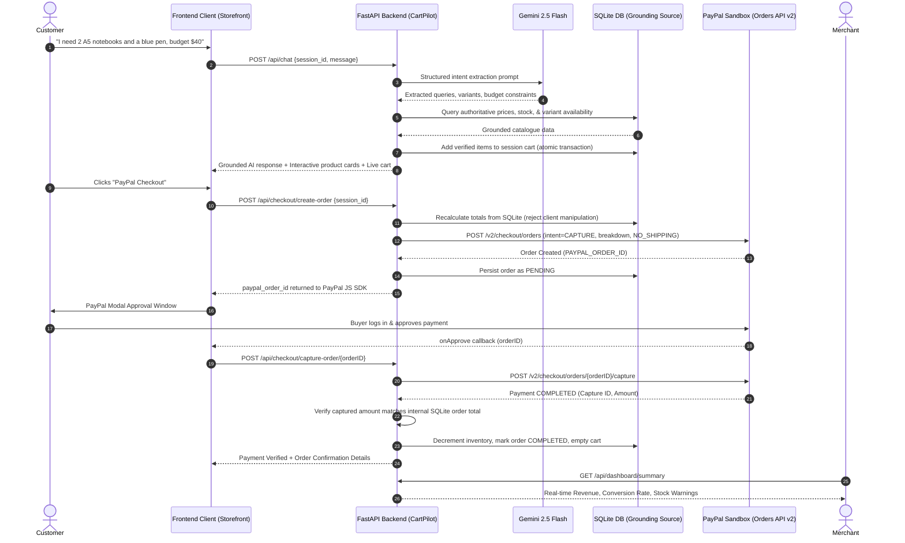

# 🛒 CartPilot AI

> **From conversation to checkout — AI-powered shopping made effortless.**  
> *Developed for the PayPal AI Hackathon 2026*

---

## 🌟 Executive Summary

Traditional online shopping forces customers to navigate cumbersome categories, endless search filters, and manual cart configurations. **CartPilot AI** replaces friction with natural conversation.

CartPilot AI is a full-stack, production-grade conversational commerce platform where **Google Gemini AI** and **PayPal Orders API v2** work in lockstep. Customers simply state what they want, specify preferences, or declare a budget (e.g., *"I need two A5 hardcover notebooks and a blue pen under $40"*), and CartPilot AI:
1. **Parses customer shopping intent** and extracts quantities, variants, and budget limits.
2. **Strictly grounds recommendations** against an authoritative SQLite inventory database — eliminating AI hallucinations, fabricated prices, and ghost stock.
3. **Synchronizes a persistent multi-session cart** with real-time recalculations and deduplication.
4. **Executes server-side PayPal Sandbox checkout** via PayPal Orders API v2 and the PayPal JavaScript SDK, with robust server-side capture verification and fraud-prevention checks.
5. **Provides a real-time Merchant Operations Dashboard** to monitor gross revenue, order fulfillment states, and low-inventory alerts.

---

## 🏗️ Architecture & Data Flow



---

## 🚀 Key Features

### 1. Conversational AI Shopping Assistant
- **Natural Language Understanding**: Powered by Google Gemini 2.5 Flash with structured Pydantic schema generation.
- **Strict Catalogue Grounding**: The AI is never trusted to determine prices, calculate subtotals, or confirm inventory. Every extracted item is looked up against SQLite.
- **Variant & Constraint Resolution**: Intelligently maps phrases like *"the large one"*, *"in A5"*, or *"blue ink"* to available product options.
- **Budget Tracking**: Alerts customers proactively if their requested bundle exceeds their declared budget.
- **Clarification Dialog**: Detects ambiguous queries (e.g., *"I want notebooks"* without a size specified) and asks targeted follow-up questions.

### 2. Persistent SQLite Cart Management
- **Database-Backed Persistence**: Session carts persist across page reloads in SQLite (WAL mode).
- **Atomic Duplicate Merging**: Adding the same item with identical variants increments quantity rather than creating duplicate lines.
- **2-Decimal Financial Arithmetic**: Uses authoritative decimal rounding to prevent floating-point inaccuracies.

### 3. Complete PayPal Sandbox Checkout (Orders API v2)
- **Zero Client Trust**: Frontend and AI amounts are discarded. The backend calculates totals strictly from authoritative database rows.
- **OAuth 2.0 In-Memory Token Caching**: Reuses PayPal bearer tokens with expiration buffers for maximum performance.
- **Modern Experience Context**: Configured with `shipping_preference: "NO_SHIPPING"`, `user_action: "PAY_NOW"`, and items marked as `category: "DIGITAL_GOODS"` to guarantee smooth popup checkout in Sandbox.
- **Strict Server-Side Capture**: Payment is captured directly on the FastAPI backend with idempotency headers (`PayPal-Request-Id`).
- **Fraud Prevention**: Verifies that the captured amount and currency strictly match the internal database record before decrementing inventory.
- **Inventory Safeguard**: Stock is never decremented at order creation; only upon verified PayPal payment capture.

### 4. Merchant Operations Dashboard
- **Live KPIs**: Total gross sales, total orders, conversion/success rate, pending payments, and catalogue count.
- **Order Audit Trail**: Detailed line items, customer details, PayPal Order IDs, and PayPal Capture IDs.
- **Low-Stock Alerts**: Flags products with stock $\le 20$ units to assist merchants with restocking.
- **Status Filtering & Search**: Instant filtering by status (`COMPLETED`, `PENDING`, `CANCELLED`, `FAILED`) and keyword search.

---

## 🛠️ Technology Stack

| Layer | Technologies |
|---|---|
| **Backend API** | Python 3.11, FastAPI, Pydantic v2, SQLite3 (WAL mode) |
| **AI / LLM** | Google Gemini 2.5 Flash, official `google-genai` SDK |
| **Payments** | PayPal Orders API v2, PayPal JavaScript SDK (Buttons component) |
| **Frontend** | Modern Vanilla HTML5, CSS3 (CSS Variables, Flexbox, Grid), ES6+ JavaScript |
| **Testing** | Python `unittest`, 70 automated test cases (Unit, API, PayPal, E2E) |

---

## 📁 Repository Structure

```text
CartPilot-AI/
├── app/
│   ├── config.py                     # Pydantic environment configuration
│   ├── main.py                       # FastAPI application entrypoint & static mounts
│   ├── database/
│   │   ├── db.py                     # SQLite connection manager, WAL mode, seed catalogue
│   │   └── product.py                # Database models & types
│   ├── routes/
│   │   ├── cart.py                   # /api/cart endpoints (GET, POST, PATCH, DELETE)
│   │   ├── chat.py                   # /api/chat AI conversational endpoint
│   │   ├── checkout.py               # /api/checkout endpoints (create, capture, cancel)
│   │   ├── dashboard.py              # /api/dashboard/summary analytics endpoint
│   │   ├── orders.py                 # /api/orders retrieval endpoints
│   │   └── products.py               # /api/products catalogue endpoints
│   ├── schemas/
│   │   ├── cart.py                   # Pydantic schemas for cart operations
│   │   ├── chat.py                   # Schemas for Gemini structured output & chat
│   │   ├── dashboard.py              # Schemas for merchant KPI dashboard
│   │   ├── order.py                  # Schemas for internal & PayPal orders
│   │   └── product.py                # Schemas for catalogue products
│   └── services/
│       ├── ai_service.py             # Gemini integration & catalogue grounding logic
│       ├── cart_service.py           # Persistent cart CRUD & pricing business logic
│       ├── catalogue_service.py      # SQLite product search & variant matching
│       ├── conversation_service.py   # Multi-turn isolated session context memory
│       ├── dashboard_service.py      # Merchant analytics aggregation queries
│       ├── order_service.py          # Order lifecycle, capture verification, stock deduction
│       └── paypal_service.py         # PayPal OAuth & Orders API v2 client
├── static/
│   ├── css/
│   │   └── style.css                 # Clean modern SaaS styling & responsive layout
│   ├── js/
│   │   └── app.js                    # Front-end store logic, chat stream, cart drawer, PayPal SDK
│   ├── checkout.html                 # Standalone PayPal Sandbox checkout tester
│   ├── dashboard.html                # Real-time Merchant Operations Dashboard
│   └── index.html                    # Unified customer store & AI shopping assistant
├── tests/
│   ├── test_ai_shopping.py           # 14 tests: Gemini parsing, grounding, variants, budgets
│   ├── test_cart.py                  # 20 tests: Cart persistence, variant deduplication, stock limits
│   ├── test_cart_api.py              # 3 tests: Cart REST endpoints
│   ├── test_catalogue.py             # 10 tests: SQLite catalogue queries & search
│   ├── test_chat_api.py              # 3 tests: Chat endpoint integration
│   ├── test_dashboard.py             # 5 tests: Merchant analytics, KPIs, low-stock alerts
│   ├── test_e2e_journey.py           # 1 test: Full end-to-end simulation from conversation to dashboard
│   ├── test_paypal_checkout.py       # 15 tests: PayPal orders, captures, fraud checks, idempotency
│   ├── test_live_gemini.py           # Live sanity test against Google GenAI API
│   └── test_live_paypal.py           # Live sanity test against PayPal Sandbox API
├── .env.example                      # Template environment variables
├── requirements.txt                  # Python dependencies
└── README.md                         # Project documentation
```

---

## ⚡ Quick Start & Setup

### 1. Prerequisites
- Python 3.10+ (Python 3.11 recommended)
- A PayPal Developer account (for Sandbox credentials)
- A Google Gemini API key (from Google AI Studio)

### 2. Clone and Setup Environment
```bash
# Clone the repository
git clone https://github.com/your-username/CartPilot-AI.git
cd CartPilot-AI

# Create virtual environment
python -m venv venv

# Activate virtual environment
# Windows:
.\venv\Scripts\activate
# Linux/macOS:
source venv/bin/activate

# Install dependencies
pip install -r requirements.txt
```

### 3. Configure Environment Variables
Create a `.env` file in the project root:
```ini
# Application Configuration
APP_ENV=development
SECRET_KEY=cartpilot_secret_key_change_in_production

# SQLite Database
DATABASE_URL=sqlite:///./cartpilot.db

# Google Gemini API
GEMINI_API_KEY=your_gemini_api_key_here
GEMINI_MODEL=gemini-2.5-flash

# PayPal Sandbox Configuration
PAYPAL_MODE=sandbox
PAYPAL_CLIENT_ID=your_paypal_sandbox_client_id
PAYPAL_CLIENT_SECRET=your_paypal_sandbox_client_secret
PAYPAL_BASE_URL=https://api-m.sandbox.paypal.com
PAYPAL_CURRENCY=USD
```

### 4. Run the Application
```bash
uvicorn app.main:app --reload --port 8000
```

Once running, navigate to:
- **Customer Store & AI Assistant**: [http://127.0.0.1:8000/static/index.html](http://127.0.0.1:8000/static/index.html)
- **Merchant Operations Dashboard**: [http://127.0.0.1:8000/static/dashboard.html](http://127.0.0.1:8000/static/dashboard.html)
- **Standalone Checkout Tester**: [http://127.0.0.1:8000/static/checkout.html](http://127.0.0.1:8000/static/checkout.html)
- **Interactive Swagger API Docs**: [http://127.0.0.1:8000/docs](http://127.0.0.1:8000/docs)

---

## 💳 PayPal Sandbox Testing Instructions

When evaluating the live PayPal Sandbox checkout:
1. **Open the Customer Storefront**: [http://127.0.0.1:8000/static/index.html](http://127.0.0.1:8000/static/index.html).
2. **Add Products**: Use the chat prompt (e.g., click the prompt chip *"📝 2 Executive Notebooks (A5)"*) or click **+ Add** in the Catalogue tab.
3. **Open Cart**: Switch to the **Shopping Cart** tab.
4. **Click the PayPal Button**: The official PayPal Sandbox modal will pop up.
5. **Log In as Buyer**:
   - Log in using a **Personal (Buyer) Sandbox account** from your [PayPal Developer Dashboard](https://developer.paypal.com) > **Sandbox** > **Accounts**.
   - ⚠️ *Important*: Do **NOT** log in using the Merchant/Seller account (`sb-uh6va53762502@business.example.com`), as PayPal prohibits merchants from buying from themselves.
   - *Tip*: If you experience browser cookie conflicts from prior PayPal sessions, test in an **Incognito / Private window**.
6. **Complete Payment**: Click **Complete Purchase** in PayPal.
7. **Verification**:
   - The backend captures the payment, verifies the transaction amount against SQLite, and displays the **Payment Verified** modal with internal Order ID and PayPal Capture ID.
   - The cart is automatically cleared and inventory decremented in SQLite.
   - Open the **Merchant Dashboard** ([http://127.0.0.1:8000/static/dashboard.html](http://127.0.0.1:8000/static/dashboard.html)) to view the updated sales total, new completed order, and live stock levels.

---

## 🧪 Automated Test Suite (70 Tests Passing)

CartPilot AI includes an automated test suite verifying every component from intent parsing to payment fraud defense:

```bash
python -m unittest discover -s tests -p "test_*.py"
```

### Test Coverage Highlights:
- **`tests/test_ai_shopping.py`** (14 tests): Gemini JSON extraction, catalogue search, stock validation, variant parsing, budget tracking, ambiguity clarification, error recovery.
- **`tests/test_cart.py`** (20 tests): Cart creation, atomic item additions, variant deduplication, quantity increments, subtotal calculations, session isolation.
- **`tests/test_paypal_checkout.py`** (15 tests): PayPal order creation, client price rejection, fraud mismatch checks, stock reduction timing, idempotency on duplicate captures.
- **`tests/test_dashboard.py`** (5 tests): Aggregated revenue calculations, order status counts, low-stock identification, recent orders retrieval.
- **`tests/test_e2e_journey.py`** (1 test): Complete end-to-end integration test spanning customer AI prompt $\rightarrow$ cart sync $\rightarrow$ PayPal order creation $\rightarrow$ capture verification $\rightarrow$ inventory decrement $\rightarrow$ merchant dashboard updates $\rightarrow$ idempotency check.
- **`tests/test_catalogue.py`** (10 tests) & **`tests/test_chat_api.py`** / **`tests/test_cart_api.py`** (5 tests): REST API endpoints and SQLite indexing.

---

## 🏆 Hackathon Judges' Demo Guide

Try these queries in the AI assistant to experience the intelligent shopping flow:

| Customer Query | What CartPilot Demonstrates |
|---|---|
| *"I need 2 executive notebooks in A5 and a blue pen. Budget is $40."* | Multi-product extraction, variant resolution, budget validation, and automated cart addition. |
| *"I want notebooks"* | Ambiguity detection; politely asks the customer which size (A5 or B5) they prefer. |
| *"Do you have any books on software engineering?"* | Semantic search across the Books category (*The Pragmatic Programmer*, *Designing Data-Intensive Applications*). |
| *"Add 100 laptop stands to my cart"* | Inventory boundary check; alerts customer that available stock is limited. |
| *"What's in my cart right now?"* | Context memory; summarizes session cart items and subtotals. |

---

## 📄 License

This project is licensed under the MIT License — see the [LICENSE](LICENSE) file for details.

# CartPilot-AI

